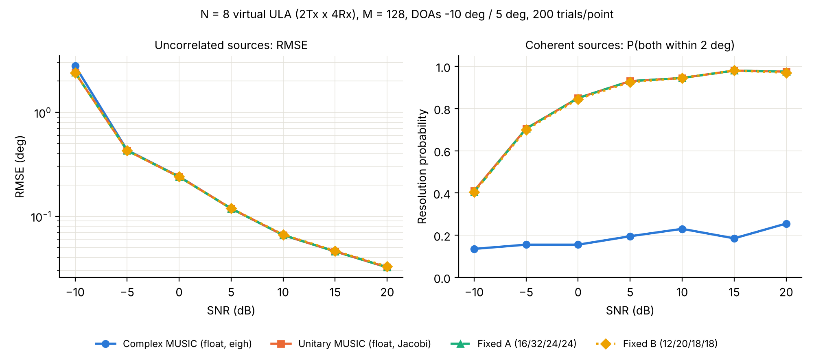

# PYNQ-Z2 Unitary MUSIC DOA Accelerator

Fixed-point, real-valued (unitary) PCA/MUSIC direction-of-arrival accelerator
for an 8-element MIMO virtual array on the PYNQ-Z2 (Zynq-7020).

> **Status:** in development.
>
> | Block | Status |
> |---|---|
> | Python golden model | Done, 10 unit tests |
> | HLS: unitary transform + real SCM | C simulation bit-exact (g++); Vitis synthesis pending |
> | HLS: Jacobi EVD, MUSIC, top-level IP | Not started |
> | Vivado block design, PYNQ overlay | Not started |

## Processing chain

```text
ARM (Python / PYNQ)                     Programmable logic (Vitis HLS, fixed-point)
virtual-array snapshots  --AXI DMA-->   [1] unitary transform + real SCM
(2 Tx x 4 Rx -> 8 elements)             [2] cyclic Jacobi EVD (PCA), 4 sweeps
                                        [3] MUSIC denominator (ROM steering) + peak search
spectrum and DOA estimates <--AXI--
```

For a centro-symmetric virtual ULA, the unitary matrix `Q` maps the complex
covariance to a real symmetric matrix, `R_re = Re{Q^H R Q}`. This halves the
covariance multipliers, replaces a complex EVD with a real Jacobi EVD, makes the
steering table real, and adds forward-backward averaging, which lets the
estimator resolve coherent sources.

## Frozen configuration

| Parameter | Value |
|---|---|
| Array | 2 Tx x 4 Rx colocated MIMO, 8-element virtual ULA, d = lambda/2 |
| Snapshots | M = 128 |
| Sources | K <= 2 (known), including coherent pairs |
| Angle grid | 181 points (1 deg) + parabolic refinement |
| Target | `xc7z020-clg400-1` (PYNQ-Z2), 100 MHz |
| Interface | AXI4-Stream in/out, AXI4-Lite control |

## Repository layout

| Folder | Contents |
|---|---|
| `python/` | Golden model, unit tests, Monte Carlo sweeps |
| `hls/` | Vitis HLS kernels (`scm`, `jacobi`, `music`) and the top-level IP (`top`), each with a testbench |
| `vivado/` | Tcl scripts that rebuild the block design from scratch (no generated project files) |
| `pynq/` | Overlay driver and Jupyter notebooks for the board |
| `results/` | Measured data and figures |
| `docs/` | Interface specification and design decisions |

Bitstreams (`.bit` / `.hwh`) are published under GitHub Releases, not committed.

## First golden-model results

200 Monte Carlo trials per point, N = 8, M = 128, DOAs -10 deg and 5 deg.



- **Uncorrelated sources:** unitary MUSIC with a fixed-sweep Jacobi EVD matches
  conventional complex MUSIC; both fixed-point configurations match floating point.
- **Coherent sources:** complex MUSIC resolves both sources in 13-26 % of trials;
  unitary MUSIC reaches 93-98 % at SNR >= 5 dB.
- **Jacobi:** four sweeps reach the fixed-point quantization floor.

## Quick start

```bash
cd python
pip install numpy matplotlib pytest
python -m pytest -q
python sweep_rmse.py 200
```

## References

This work builds on S. Lahti et al., "An Efficient High-level Synthesis
Implementation of the MUSIC DoA Algorithm for FPGA," IEEE DDECS 2024
([doi:10.1109/DDECS60919.2024.10508912](https://doi.org/10.1109/DDECS60919.2024.10508912)),
and on the unitary transformation of K.-C. Huarng and C.-C. Yeh, IEEE TSP 1991
([doi:10.1109/78.80927](https://doi.org/10.1109/78.80927)). The predecessor
covariance-kernel design-space study is in
[fpga-hls-doa-scm-accelerator](https://github.com/hmolhem/fpga-hls-doa-scm-accelerator).

## License

MIT. See [LICENSE](LICENSE).
