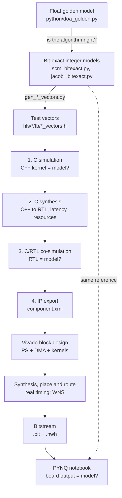
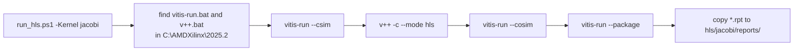
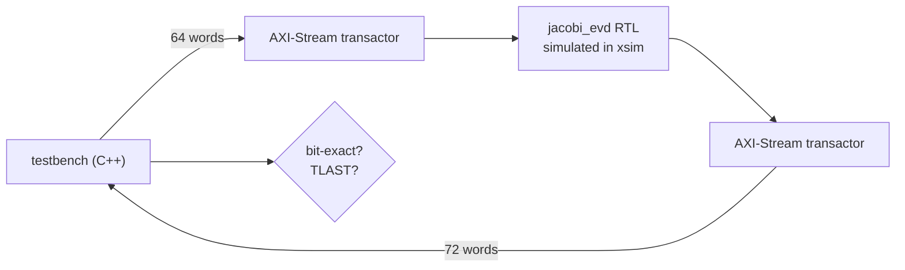
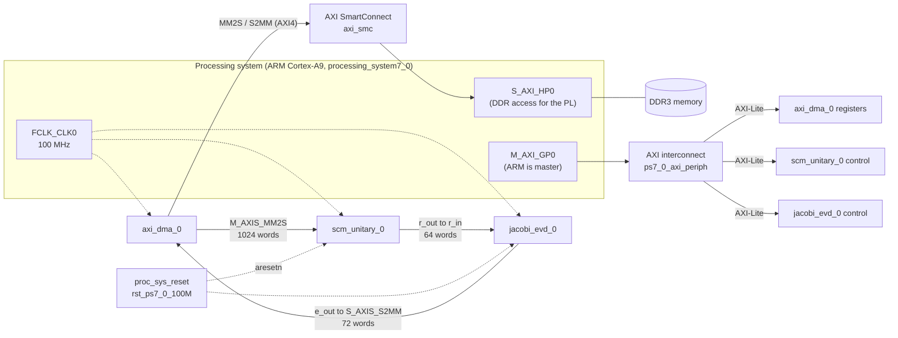
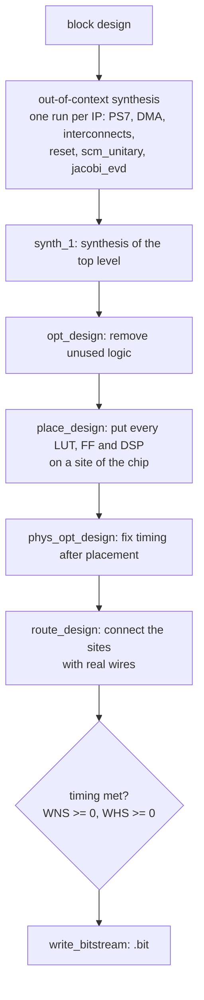
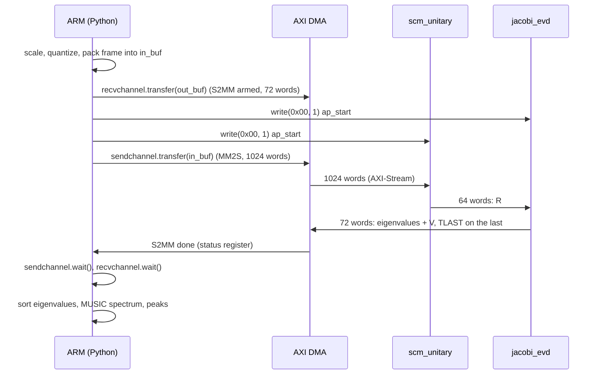

# Design flow: from the Python model to the board

This guide explains what happens at every step of the project flow, from the Python model to a
DOA estimate on the PYNQ-Z2: which files go in, what the tools do with them, what comes out,
and how to read the results. It follows the Tier 2 design (`scm_unitary` + `jacobi_evd`); Tier 1
and Tier 3 use the same flow.

Contents

1. [The big picture](#1-the-big-picture)
2. [Step 0: reference models in Python](#2-step-0-reference-models-in-python)
3. [Vitis HLS: from C++ to a hardware IP](#3-vitis-hls-from-c-to-a-hardware-ip)
4. [Vivado: from IPs to a bitstream](#4-vivado-from-ips-to-a-bitstream)
5. [PYNQ: running the overlay on the board](#5-pynq-running-the-overlay-on-the-board)
6. [Evidence levels](#6-evidence-levels)
7. [Problems we met and their fixes](#7-problems-we-met-and-their-fixes)
8. [Glossary](#8-glossary)

---

## 1. The big picture

Every hardware block is checked against the **same reference**: an integer Python model that
reproduces the hardware arithmetic bit for bit. Each tool step adds one level of realism, and at
each level the output is compared with that reference.



Where each step runs:

| Step | Tool | Where | Typical time |
|---|---|---|---|
| Models, vectors, Monte Carlo | Python (numpy) | cloud or laptop | seconds to minutes |
| g++ C simulation (CI) | g++ + open-source `ap_int` headers | GitHub Actions, every push | 1 min |
| C simulation, synthesis, co-simulation, IP export | Vitis HLS 2025.2 (`hls/run_hls.ps1`) | laptop | 3-10 min |
| Block design to bitstream | Vivado 2025.2 (`vivado/*/build_*.tcl`) | laptop | 20-40 min |
| Board test | PYNQ 2.5 + Jupyter notebook | PYNQ-Z2 | minutes |

---

## 2. Step 0: reference models in Python

| File | Role |
|---|---|
| `python/doa_golden.py` | Floating-point reference of the whole chain: array, snapshots, unitary SCM, Jacobi, MUSIC, peaks |
| `python/scm_bitexact.py` | Integer model of `hls/scm`: same additions, products and the single rounding |
| `python/jacobi_bitexact.py` | Integer model of `hls/jacobi`: CORDIC iterations, rounding of every product |
| `python/gen_scm_vectors.py`, `gen_jacobi_vectors.py` | Write the test vectors as C headers for the HLS testbenches |
| `python/test_*.py` | Unit tests (pytest), run in CI |

**Why bit-exact?** A floating-point model can only say "close enough". An integer model that
performs exactly the operations of the hardware gives one correct answer per input, so a single
wrong bit anywhere is detected. This is possible because both kernels use only additions,
shifts and products with a defined rounding (no `sqrt`, no division, no floating point).

**Why compile the vectors into a header?** The testbench then needs no data files, so the same
testbench runs unchanged in C simulation, in co-simulation and with g++ in CI.

---

## 3. Vitis HLS: from C++ to a hardware IP

High-level synthesis (HLS) turns a C++ function into a digital circuit (RTL: Verilog/VHDL).
The function arguments become hardware ports, loops become state machines and pipelines,
arrays become registers or block RAM, and arithmetic becomes LUTs and DSP slices.

### 3.1 Input files

```text
hls/jacobi/
  jacobi_evd.h          types, constants, top-level function prototype
  jacobi_evd.cpp        the kernel (synthesized)
  tb/tb_jacobi_evd.cpp  testbench (simulation only, never synthesized)
  tb/jacobi_vectors.h   test vectors from python/gen_jacobi_vectors.py
  hls_config.cfg        tool settings
```

`hls_config.cfg`, line by line:

| Line | Meaning |
|---|---|
| `part=xc7z020clg400-1` | The FPGA on the PYNQ-Z2 (Zynq-7020, package clg400, speed grade -1) |
| `flow_target=vivado` | Produce an IP for Vivado (not a Vitis acceleration kernel) |
| `clock=100MHz` | Target clock: 10 ns per cycle |
| `syn.file=...` | Files that are synthesized into hardware |
| `syn.top=jacobi_evd` | The function that becomes the IP |
| `tb.file=...` | Testbench files, used only in simulation |
| `cosim.trace_level=none` | Do not dump waveforms (faster co-simulation) |
| `package.output.format=ip_catalog` | Export as a Vivado IP catalog entry |

### 3.2 What `run_hls.ps1` does



All tool output goes to `hls/jacobi/work/` (ignored by git). The script stops at the first step
that fails and prints `=== <step> FAILED ===` in red. The reports copied to `reports/` are
committed as evidence.

### 3.3 Step 1: C simulation (`--csim`)

The kernel and the testbench are compiled as an ordinary C++ program and run on the PC. No
hardware is involved. `ap_int<W>` types behave exactly like W-bit hardware integers, and
`hls::stream` behaves like a FIFO.

The testbench (`tb_jacobi_evd.cpp`) does, for each of the 14 test frames:

1. writes the 64 input words into the input stream, with TLAST on the last one;
2. calls `jacobi_evd(r_in, e_out)`;
3. reads the 72 output words and compares each with the expected value from the Python model;
4. checks that TLAST is set exactly on word 71 and that no words are left in the streams.

It prints `PASS: 14 frames, all 1008 outputs bit-exact` and returns 0, or `FAIL` and returns 1.

**What it proves:** the C++ code computes exactly what the model computes.
**What it does not prove:** anything about timing, resources, or the generated circuit.

Log: `work/hls/csim/report/jacobi_evd_csim.log`.

### 3.4 Step 2: C synthesis (`v++ -c --mode hls`)

This is the actual translation into hardware. The tool:

- **Schedules** every operation into a clock cycle, respecting data dependences and the
  delay of each operator (an operation chain that does not fit into 10 ns is split over cycles).
- **Binds** operations to hardware: multiplications to DSP48 slices, additions, shifts and
  comparisons to LUTs, variables to flip-flops.
- **Applies the pragmas** in the code:

| Pragma in our kernels | Effect |
|---|---|
| `INTERFACE mode=axis port=r_in` | The stream argument becomes an AXI4-Stream port (TDATA, TVALID, TREADY, TLAST) |
| `INTERFACE mode=s_axilite port=return bundle=control` | Adds an AXI4-Lite register block with `ap_start` / `ap_done` / `ap_idle` at offset 0x00 |
| `PIPELINE II=1` | A new loop iteration starts every cycle (iterations overlap like an assembly line) |
| `PIPELINE II=8` (SCM) | A new snapshot every 8 cycles, matching the stream rate of one sample per cycle |
| `ARRAY_PARTITION type=complete` | The array becomes individual registers, so all elements can be read in the same cycle |
| `DEPENDENCE ... inter false` | Tells the tool that two loop iterations never touch the same element, so it may overlap them |
| `INLINE off` | Keeps a function (the CORDIC units) as its own hardware module |

**Reading `jacobi_evd_csynth.rpt`:**

| Section | What to look at | Tier 2 value |
|---|---|---|
| Timing | Estimated clock must be below the target (10 ns). The estimate includes a 2.7 ns uncertainty margin and is usually pessimistic. | 9.609 ns |
| Latency | Cycles from `ap_start` to `ap_done`. A range means data-dependent loops. | 6,649 - 10,121 |
| Loop table | Trip count, iteration latency, achieved vs target II. If achieved II > target, something blocks the pipeline. | Update loop II = 1 achieved |
| Utilization | BRAM, DSP, FF, LUT of this IP alone (no DMA or processor). | 48 DSP, 13,209 LUT |

Why the Jacobi latency is about 9,000 cycles: 4 sweeps x 28 rotations = 112 rotations, and
each rotation needs up to 33 cycles (vectoring CORDIC) + 26 (rotation CORDIC) + 16 (update loop)
+ a few cycles for the diagonal update.

### 3.5 Step 3: C/RTL co-simulation (`--cosim`)

The same testbench runs again, but the call to `jacobi_evd` now drives the **generated RTL**
in the Xilinx simulator (xsim). The testbench data is converted into AXI-Stream transactions,
the RTL is simulated cycle by cycle, and the RTL outputs are converted back and compared by the
same testbench code.



**What it proves:** the circuit that HLS generated does exactly what the C++ code does, so
the translation is correct. It also **measures** the real number of cycles per call.
`jacobi_evd_cosim.rpt` shows min / avg / max latency over the 14 frames (6,199 / 9,061 / 9,447).

It is the slowest HLS step (4-5 minutes here) because every signal is simulated in every cycle.

### 3.6 Step 4: IP export (`--package`)

The RTL is packaged as a Vivado IP: `work/hls/impl/ip/component.xml` plus the HDL files. The
XML describes the ports (`r_in`, `e_out`, `s_axi_control`, `ap_clk`, `ap_rst_n`) and the
register map, so Vivado can place the IP in a block design and connect it automatically. The
Vivado script finds the IP by searching for this `component.xml`.

---

## 4. Vivado: from IPs to a bitstream

### 4.1 The block design

The script `vivado/tier2_overlay/build_tier2_overlay.tcl` builds this system:



The script, section by section:

| Section | What it does |
|---|---|
| 1. Board files | Finds the PYNQ-Z2 board definition (DDR timing, MIO pins of the processor). Adds the Vivado Store folder to the search path; downloads it if missing. |
| HLS IP repositories | Finds `component.xml` of both kernels under `hls/scm/work` and `hls/jacobi/work`. |
| 2. Project and block design | Creates the project, the PS with the board preset (100 MHz fabric clock, HP0 and GP0 enabled), the AXI DMA in simple mode, and both kernels. |
| Connection automation | `apply_bd_automation` adds the AXI interconnect (control path), the SmartConnect (memory path), the reset block, and connects clocks. |
| Streams | `connect_bd_intf_net` wires DMA, `scm_unitary`, `jacobi_evd` and DMA in a chain. |
| `assign_bd_address` | Gives every AXI-Lite slave an address in the ARM memory map. These addresses go into the `.hwh` file. |
| `validate_bd_design` | Checks widths, clocks and connections. |
| 3. Build | `generate_target`, HDL wrapper, then `launch_runs impl_1 -to_step write_bitstream`. |
| 4. Outputs | Copies `.bit` and `.hwh` to `output/` with the same base name; writes utilization and timing reports; prints WNS. |

### 4.2 What happens during the build



The `runme.log` files in `vivado/tier2_overlay/build/tier2_overlay.runs/*/` show the progress.
The phases we saw ("Phase 2.4 Global Place", "Phase 2.3 Update Timing" inside the router) are
sub-steps of placement and routing.

### 4.3 Reading the timing result

At 100 MHz every register-to-register path must settle within 10 ns.

| Value | Meaning | Tier 2 |
|---|---|---|
| **WNS** (worst negative slack, setup) | Margin of the slowest path: 10 ns minus its delay. Must be >= 0. | +0.892 ns |
| **TNS** (total negative slack) | Sum over all failing paths; 0 when all pass. | 0.000 |
| **WHS** (worst hold slack) | Margin against data changing too early after a clock edge. Must be >= 0. | +0.009 ns |

HLS estimated 9.6 ns for the Jacobi kernel alone. Vivado's figure is the real one: the
slowest path takes about 9.1 ns. Tier 1 had +2.157 ns; the smaller margin of Tier 2 comes from
the CORDIC and update logic.

### 4.4 The two output files

| File | Content | Used by |
|---|---|---|
| `tier2_overlay.bit` | Configuration of every LUT, FF, DSP and wire of the FPGA | PYNQ writes it into the FPGA |
| `tier2_overlay.hwh` | Hardware handoff: the list of IPs, their types and their register addresses (XML) | PYNQ reads it to build `ol.ip_dict` and the drivers |

They must have the same base name and sit in the same folder on the board.

---

## 5. PYNQ: running the overlay on the board

### 5.1 Loading

```python
ol = Overlay("tier2_overlay.bit")
```

PYNQ writes the bitstream into the FPGA through the Linux FPGA manager, reads the `.hwh`,
and creates one Python object per IP: `ol.axi_dma_0` (with a DMA driver), `ol.scm_unitary_0`
and `ol.jacobi_evd_0` (generic register access through `.write(offset, value)`).

```python
in_buf  = allocate(shape=(1024,), dtype=np.uint32)
out_buf = allocate(shape=(72,),   dtype=np.uint32)
```

`allocate` reserves **physically contiguous** memory: the DMA works with physical addresses and
cannot follow the scattered pages of ordinary Python memory.

### 5.2 One accelerator call



Details that matter:

- The receive channel is armed **before** sending, so no output word is lost.
- `jacobi_evd` is started before `scm_unitary`: it then simply waits for its input stream.
- The S2MM channel finishes only when it sees **TLAST**. This is why every kernel sets TLAST on
  its last output word; without it the notebook would hang in `recvchannel.wait()`.
- `transfer()` also flushes or invalidates the CPU cache for the buffer, so the ARM and the
  DMA see the same data.

### 5.3 Why one call takes ~745 us when the kernels need ~102 us

The kernels need 1,104 + about 9,061 cycles = about 102 us. The rest of the 745 us is the
Python and driver path on the 650 MHz Cortex-A9: cache maintenance, register writes, and the
polling loops in `wait()`. The pure DMA loopback with no computation already takes 546 us. The
remedies are to measure kernel time with a PL cycle counter and to send several frames per
transfer, so that the fixed cost is shared.

---

## 6. Evidence levels

Numbers from different levels are never mixed in the report:

| Level | Source | Example |
|---|---|---|
| Software | Python models, Monte Carlo | fixed-point chain = float DOA in 200 trials |
| HLS estimate | `*_csynth.rpt` | Jacobi 6,649 - 10,121 cycles, 9.609 ns |
| Co-simulation | `*_cosim.rpt` | Jacobi avg 9,061 cycles, bit-exact |
| Implementation | Vivado `timing_summary.rpt`, `utilization.rpt` | WNS +0.892 ns, 120 DSP |
| Board | notebook output | 20/20 frames bit-exact, 744.5 us per frame |

---

## 7. Problems we met and their fixes

| Problem | Cause | Fix |
|---|---|---|
| `source` does not work in PowerShell | `source` is a Tcl/bash command | `& "C:\AMDXilinx\2025.2\Vivado\bin\vivado.bat" -mode batch -source x.tcl` |
| Vivado seems stuck for a minute at the start | It downloads the board catalog | Script adds the Vivado Store board folder to `board.repoPaths` |
| `git pull`: untracked files would be overwritten | `run_hls.ps1` wrote reports that were also committed | Delete the local `hls\<kernel>\reports` folder, then `git pull` |
| DONE LED stays off | SD card pushed out of the push-push slot | Power off, reseat the card until it clicks, power on |
| Notebook hangs in `wait()` | Output stream without TLAST, or a kernel not started | Every kernel sets TLAST; write `ap_start` to every kernel before sending |
| HLS used 72 DSP for SCM (9 would do) | HLS did not share multipliers across the II = 8 interval | Open design-space item: `ALLOCATION` / `BIND_OP` |

---

## 8. Glossary

| Term | Meaning |
|---|---|
| AXI4-Stream | Point-to-point data stream: TDATA, TVALID (sender has data), TREADY (receiver accepts), TLAST (last word of a packet) |
| AXI4-Lite | Simple register bus; the ARM uses it to start kernels and to program the DMA |
| AXI DMA | Moves data between DDR memory and AXI-Stream: MM2S (memory to stream) and S2MM (stream to memory) |
| `ap_start` / `ap_done` | Bits 0 and 1 of the HLS control register at offset 0x00 |
| II (initiation interval) | Cycles between the start of two consecutive loop iterations |
| Latency | Cycles from start to finish of one call |
| LUT / FF / DSP / BRAM | FPGA resources: logic tables, flip-flops, multiplier slices, block memories |
| PS / PL | Processing system (ARM) / programmable logic (FPGA fabric) |
| HP0 / GP0 | High-performance port (PL reads and writes DDR) / general-purpose port (ARM accesses PL registers) |
| WNS / WHS | Setup / hold slack of the worst path, must be >= 0 |
| Overlay | A bitstream plus its `.hwh`, loaded at run time by PYNQ |
| CORDIC | Shift-and-add algorithm for angles, sines and cosines, used here instead of `sqrt` and division |
| Bit-exact | Every output bit equals the reference model's output |
