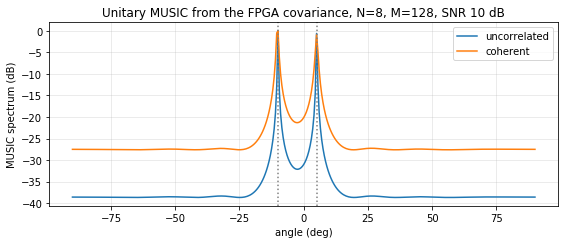

# SCM overlay on PYNQ-Z2 -- first on-board run (2026-10-17)

Board: PYNQ-Z2, PYNQ 2.5 image (Python 3.6, numpy 1.13.3).
Overlay: `vivado/scm_overlay` (Vivado 2025.2), notebook `pynq/notebooks/02_scm_on_board.ipynb`.

## Implementation (post place-and-route, whole overlay: PS + AXI DMA + scm_unitary)

| Metric | Value |
|---|---|
| WNS / WHS at 100 MHz | +2.157 ns / +0.024 ns |
| LUT | 6,598 (12.4 %) |
| FF | 8,798 (8.3 %) |
| BRAM tiles | 2 (1.4 %) |
| DSP | 72 (32.7 %) |

Reports: `vivado/scm_overlay/reports/`.

## Functional result

| Test | Result |
|---|---|
| 50 random frames, board output vs integer model | 50 / 50 bit-exact |
| DOA, uncorrelated sources at -10 / 5 deg, SNR 10 dB, M = 128 | estimated -10 / 5 deg |
| DOA, coherent sources at -10 / 5 deg, SNR 10 dB, M = 128 | estimated -10 / 5 deg |

MUSIC (eigh + spectrum) runs on the ARM from the hardware covariance (Tier 1 partition).

## Timing (median of 200, host-observed with `time.perf_counter`)

| Path | Time |
|---|---:|
| FPGA: DMA transfer + `scm_unitary` IP, one frame | 687.4 us |
| NumPy float SCM (unitary), ARM Cortex-A9 | 879.9 us |
| NumPy integer bit-exact model, ARM | 1104.8 us |
| `scm_unitary` IP alone (HLS synthesis / cosim) | 11.06 us / 11.04 us |

Interpretation: the IP itself is about 80x faster than NumPy on the ARM, but the host-observed
gain is only 1.28x because about 676 us per call is Python/driver overhead (cache maintenance,
register polling), consistent with the 546 us DMA-loopback round trip. Next steps: batch
several frames per DMA transfer and measure the IP with a PL cycle counter.
