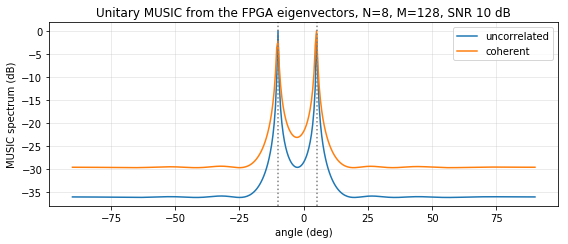

# Tier 2 overlay on PYNQ-Z2 -- covariance and PCA on the FPGA (2026-10-20)

Board: PYNQ-Z2, PYNQ 2.5 image (Python 3.6, numpy 1.13.3).
Overlay: `vivado/tier2_overlay` (Vivado 2025.2): AXI DMA -> `scm_unitary` -> `jacobi_evd` -> AXI DMA.
Notebook: `pynq/notebooks/03_tier2_on_board.ipynb`.

## HLS: `jacobi_evd` (Vitis HLS 2025.2, `hls/jacobi/reports/`)

| Metric | Value |
|---|---|
| C simulation | PASS, 14 frames, 1008 words bit-exact |
| Latency, synthesis | 6,649 - 10,121 cycles (66.5 - 101.2 us) |
| Latency, co-simulation | min 6,199 / avg 9,061 / max 9,447 cycles; PASS, bit-exact |
| Estimated clock | 9.609 ns (target 10 ns) |
| DSP / LUT / FF / BRAM | 48 / 13,209 / 11,189 / 0 |

The latency depends on the data only through the CORDIC vectoring, which ends early when a_pq = 0.

## Implementation (post place-and-route, whole overlay)

| Metric | Value |
|---|---|
| WNS / WHS at 100 MHz | +0.892 ns / +0.009 ns |
| LUT | 20,318 (38.2 %) |
| FF | 16,526 (15.5 %) |
| BRAM tiles | 2 (1.4 %) |
| DSP | 120 (54.5 %) |

Reports: `vivado/tier2_overlay/reports/`.

## Functional result

| Test | Result |
|---|---|
| 20 random frames, board eigenvalues and eigenvectors vs integer models (SCM + Jacobi) | 20 / 20 bit-exact |
| Board eigenvalues vs LAPACK `eigh` on the same covariance | max error 7.71e-8 |
| Orthogonality of the board eigenvectors, max \|V^T V - I\| | 7.55e-8 |
| DOA, uncorrelated sources at -10 / 5 deg, SNR 10 dB, M = 128 | estimated -10 / 5 deg |
| DOA, coherent sources at -10 / 5 deg, SNR 10 dB, M = 128 | estimated -10 / 5 deg |

MUSIC (spectrum and peak search) runs on the ARM from the hardware signal subspace (Tier 2
partition): the ARM receives only 72 words (eigenvalues + eigenvectors) per frame.

## Timing (median of 200, host-observed with `time.perf_counter`)

| Path | Time |
|---|---:|
| FPGA: DMA transfers + `scm_unitary` + `jacobi_evd`, one frame | 744.5 us |
| NumPy float SCM + `eigh` (LAPACK), ARM Cortex-A9 | 1219.3 us |
| Integer bit-exact model SCM + Jacobi, ARM (pure Python) | 56,253 us |
| IPs alone (co-simulation): 1,104 + ~9,061 cycles | ~101.7 us |

Interpretation: the host-observed gain over NumPy grows from 1.28x (Tier 1) to 1.64x, because
the EVD moved into the PL while the per-call overhead stayed the same. The FPGA path costs only
57 us more than Tier 1 although it now includes the whole EVD; the fixed ~640 us of Python and
driver overhead per call still dominates, so batching several frames per transfer remains the
main lever for throughput.
