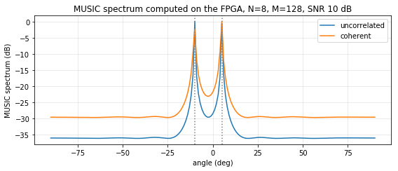

# Tier 3 overlay on PYNQ-Z2 -- the whole DOA estimator on the FPGA (2026-11-07)

Board: PYNQ-Z2, PYNQ 2.5 image (Python 3.6, numpy 1.13.3).
Overlay: `vivado/tier3_overlay` (Vivado 2025.2): AXI DMA -> `scm_unitary` -> `jacobi_evd` ->
`music_doa` -> AXI DMA, plus an AXI Timer capturing the DMA interrupts.
Notebook: `pynq/notebooks/04_tier3_on_board.ipynb`.

## HLS: `music_doa` (Vitis HLS 2025.2, `hls/music/reports/`)

| Metric | Value |
|---|---|
| C simulation | PASS, 25 frames + a batch of 3, 4,575 words bit-exact |
| Latency, synthesis | 660 - 772 cycles (6.6 - 7.7 us) |
| Latency, co-simulation | min 658 / avg 758 / max 766 cycles; PASS, bit-exact |
| Estimated clock | 7.404 ns (target 10 ns) |
| DSP / LUT / FF / BRAM_18K | 40 / 6,469 / 10,561 / 10 |

## Design-space variants (HLS synthesis, `hls/dse/*/reports/`)

| Variant | Latency (cycles) | DSP | LUT | Est. clock |
|---|---|---|---|---|
| SCM, 72 multipliers (implemented) | 1,106 | 72 | 3,973 | 6.847 ns |
| SCM, 9 shared multipliers | 1,106 (II 8) | 9 | 5,460 | 5.587 ns |
| Jacobi, 24 CORDIC iterations (implemented) | 6,649 - 10,121 | 48 | 13,209 | 9.609 ns |
| Jacobi, 20 CORDIC iterations | 6,201 - 9,225 | 48 | 13,209 | 9.609 ns |
| Jacobi, 16 CORDIC iterations | 5,753 - 8,329 | 48 | 13,211 | 9.609 ns |

## Implementation (post place-and-route, whole overlay)

| Metric | Value |
|---|---|
| WNS / WHS at 100 MHz | +0.623 ns / +0.015 ns |
| LUT | 24,332 (45.7 %) |
| FF | 21,792 (20.5 %) |
| BRAM tiles | 7 (5.0 %) |
| DSP | 160 (72.7 %) |

## Functional result

| Test | Result |
|---|---|
| 20 random frames, board output (2 angles + 181-point spectrum) vs integer models of all three kernels | 20 / 20 bit-exact |
| DOA from the FPGA, uncorrelated sources at -10 / 5 deg, 10 dB | -10.022 / 5.050 deg |
| DOA from the FPGA, coherent sources at -10 / 5 deg, 10 dB | -10.163 / 4.830 deg |

## Monte Carlo through the board (100 trials per point, M = 128, sources at -10 / 5 deg)

| Sources | SNR | RMSE (deg) | P(both within 2 deg) |
|---|---:|---:|---:|
| uncorrelated | 0 dB | 0.2161 | 1.00 |
| uncorrelated | 10 dB | 0.0714 | 1.00 |
| uncorrelated | 20 dB | 0.0340 | 1.00 |
| coherent | 0 dB | 7.6947 | 0.85 |
| coherent | 10 dB | 5.4661 | 0.92 |
| coherent | 20 dB | 0.0910 | 1.00 |

Consistent with the simulation of the bit-exact chain (uncorrelated RMSE 0.239 / 0.066 /
0.032 deg; coherent resolution 0.85 / 0.945 / 0.975 with 200 trials). The coherent RMSE is
dominated by the unresolved trials.

## Timing

| Path | Evidence level | Time per frame |
|---|---|---:|
| FPGA, whole estimator, one frame per call (DMA + 3 IPs) | board, host-observed (median of 200) | 784.1 us |
| NumPy float SCM + `eigh` + MUSIC + peaks, ARM Cortex-A9 | board, host-observed (median of 200) | 2543.5 us |
| PL latency: input accepted -> output in DDR (AXI Timer, median of 200) | board, cycle counter | 10,212 cycles |
| PL latency incl. streaming the 1024 input words | board, cycle counter | ~11,236 cycles = 112.4 us |
| Three kernels, co-simulation (1,104 + 9,061 + 758) | co-simulation | 10,923 cycles = 109.2 us |
| Batched: 100 frames per DMA transfer, PL | board, cycle counter | 10,404 cycles = 104.0 us (9,612 frames/s) |
| Batched: 100 frames per DMA transfer, host-observed | board, host-observed | 112.6 us |

Interpretation:
- The host-observed speed-up over NumPy grows from 1.28x (Tier 1) and 1.64x (Tier 2) to 3.2x
  with the whole estimator on the FPGA.
- The cycle counter confirms the co-simulation latency on the board (about 3 % higher, from
  the DMA and interconnect).
- With 100 frames per transfer the Python overhead almost disappears: the host-observed time per
  frame (112.6 us) is within 8 % of the PL time (104.0 us), 7x better than one frame per call.
- The minimum of the cycle-counter run (6,241 cycles) is a single outlier from the first
  capture; median and maximum are identical (10,212 cycles).
